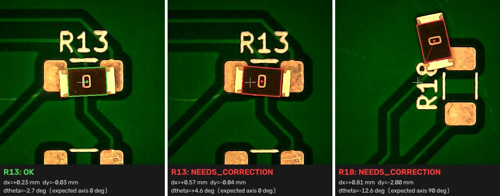
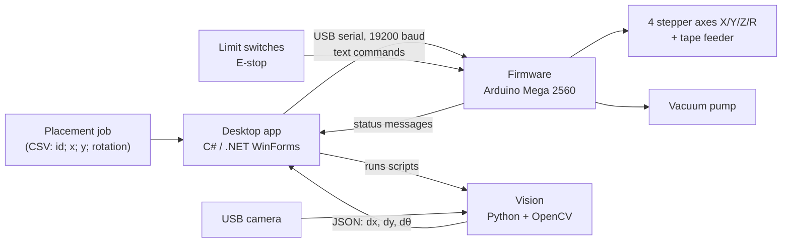
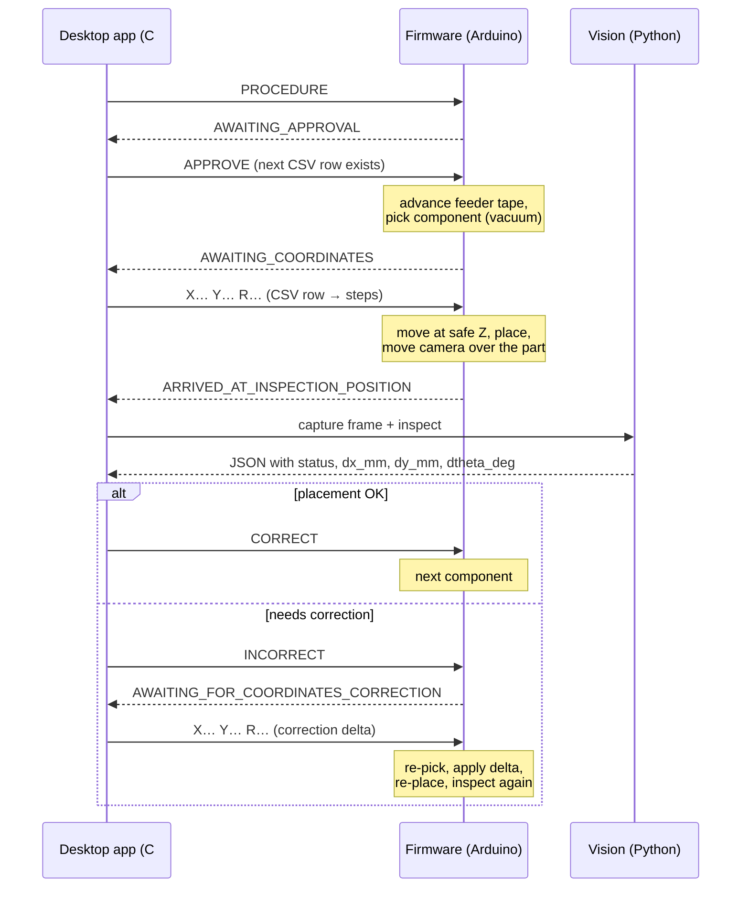

# Vision-Assisted Pick-and-Place Machine

B.Sc. thesis project at **Poznan University of Technology** (Automatic Control and Robotics, 2026):
*"Extending the functionality of the pick and place assembly machine"*, graded **5.0/5**. Team of three.

We largely rebuilt and extended an existing pick-and-place machine. The finished machine has four axes (X, Y, Z and nozzle rotation), vacuum pick-up from a tape feeder, homing, limit switches and an emergency stop. A camera checks every placed SMD component. If the part is off target, the machine picks it up again and places it with a correction calculated from the image.

**▶ [Video and photos of the machine](https://drive.google.com/drive/folders/1oUsL36W5xF7MOcfplsbzDsKNx6uT25sq)**


*The inspection code from `vision/` run on frames captured by the machine. The white cross marks the expected pad centre and the box marks the detected resistor body. Components outside ±0.35 mm or ±10° are flagged for correction.*

---

## How it works



**Placement cycle with closed-loop correction.** The firmware runs the motion state machine. The desktop app supplies coordinates and inspection results:



## Repository layout

| Folder | Contents |
|---|---|
| [`desktop-app/`](desktop-app) | C# (.NET 9, WinForms) control application: serial connection, manual jog, reference points (PCB/pick), CSV placement jobs, running the vision pipeline, camera-offset recalibration, log console, light/dark theme |
| [`vision/`](vision) | Python/OpenCV scripts called by the desktop app: frame capture, live view with crosshair, resistor detection and offset calculation |
| [`firmware/main/`](firmware/main) | Arduino Mega firmware: command parser, AccelStepper motion, homing, limit handling, E-stop, feeder, placement/correction state machine, camera-offset calibration stored in EEPROM |
| [`hardware/cad/`](hardware/cad) | STEP files of the 3D-printed parts: component feeder, PCB holder, camera holder, spool, limit-switch and E-stop holders |

## My role (Aleksander Bruski)

- Built the **desktop control application** in C#: the serial protocol with the firmware, the placement-job workflow from CSV, integration of the Python vision scripts and the recalibration tool.
- Designed the **3D-printed mechanical parts** in Fusion 360 (`hardware/cad/`).
- Responsible for **integrating and debugging the whole system** (app ↔ firmware ↔ vision ↔ mechanics).

## Team

- **Aleksander Bruski**: desktop application, mechanical parts, system integration
- **Kacper Biadała**: vision system (Python, OpenCV)
- **Shadi Frayhat**: Arduino firmware

Thesis supervisor: Adam Bondyra (Poznan University of Technology).

## Running it

The code is written for this specific machine (pinout, steps/mm and camera position are hard-coded), so it is here mainly as a reference. If you want to run it:

1. **Firmware.** Open `firmware/main/main.ino` in the Arduino IDE, install the **AccelStepper** library and upload it to an Arduino Mega 2560. Pinout and steps/mm are in `Config.h` / `Config.cpp`.
2. **Vision.** Create the virtual environment where the desktop app expects it:
   ```
   cd vision
   py -3.11 -m venv venv
   venv\Scripts\pip install -r requirements.txt
   ```
   You can test detection on a single image: `venv\Scripts\python inspect_resistor.py --id R1 --image frame.png --expected-axis 0`
3. **Desktop app.** Open `desktop-app/PickAndPlace.sln` in Visual Studio 2022 (.NET 9 SDK, Windows) and run it. The app finds `vision/` relative to its build folder, so keep the repository layout unchanged.
4. In the app: connect to the COM port → **HOME** → set the pick and PCB reference points → load the placement CSV → start the procedure.

Placement job format (semicolon-separated, the first line is a header, coordinates in mm relative to the PCB reference, rotation snapped to 0° or 90°):

```
id;x;y;rotation
R13;12.70;8.40;0
R17;20.30;15.10;90
```

## Tech stack

C# · .NET 9 · WinForms · System.IO.Ports · Python 3.11 · OpenCV · NumPy · Arduino (C++) · AccelStepper · EEPROM · Fusion 360 · 3D printing

## License

No open-source licence is granted at the moment. The code is published for portfolio and reference purposes. If you would like to reuse parts of it, please get in touch.
